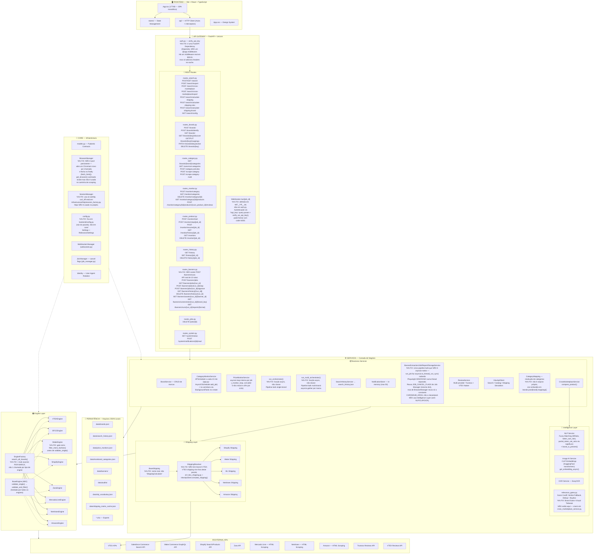
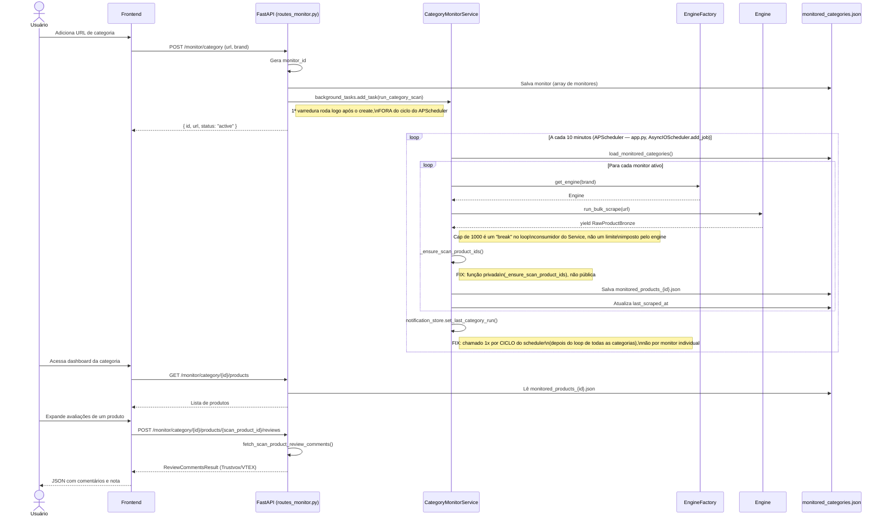
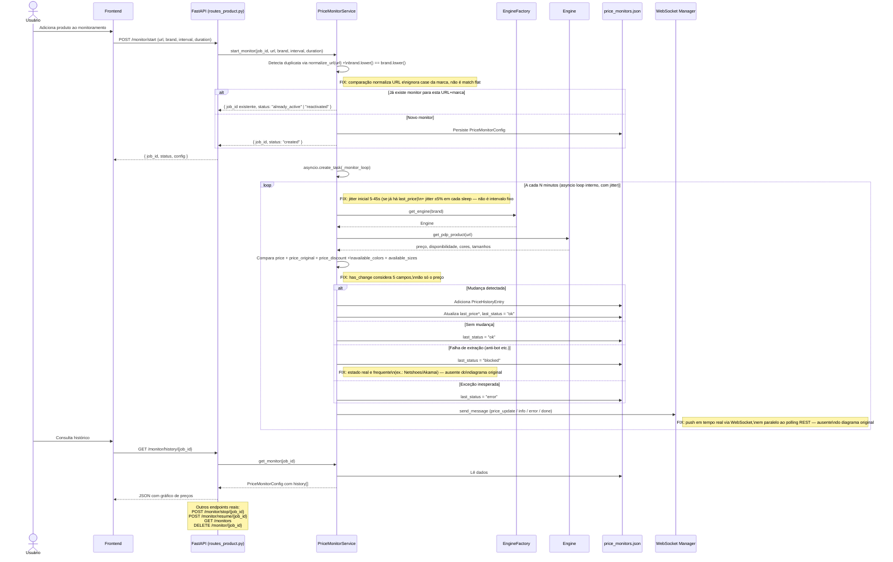
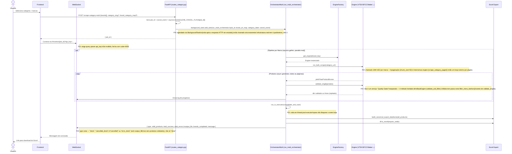
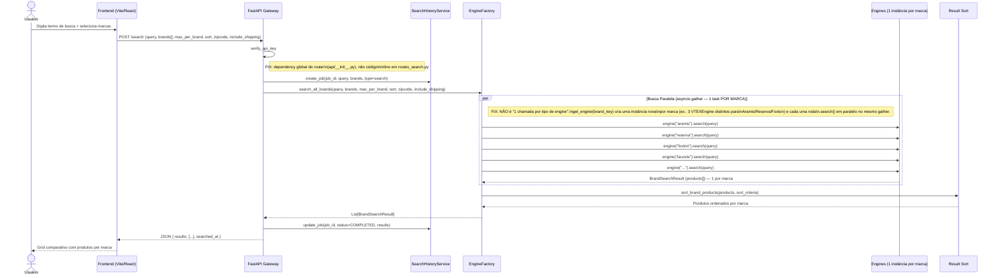
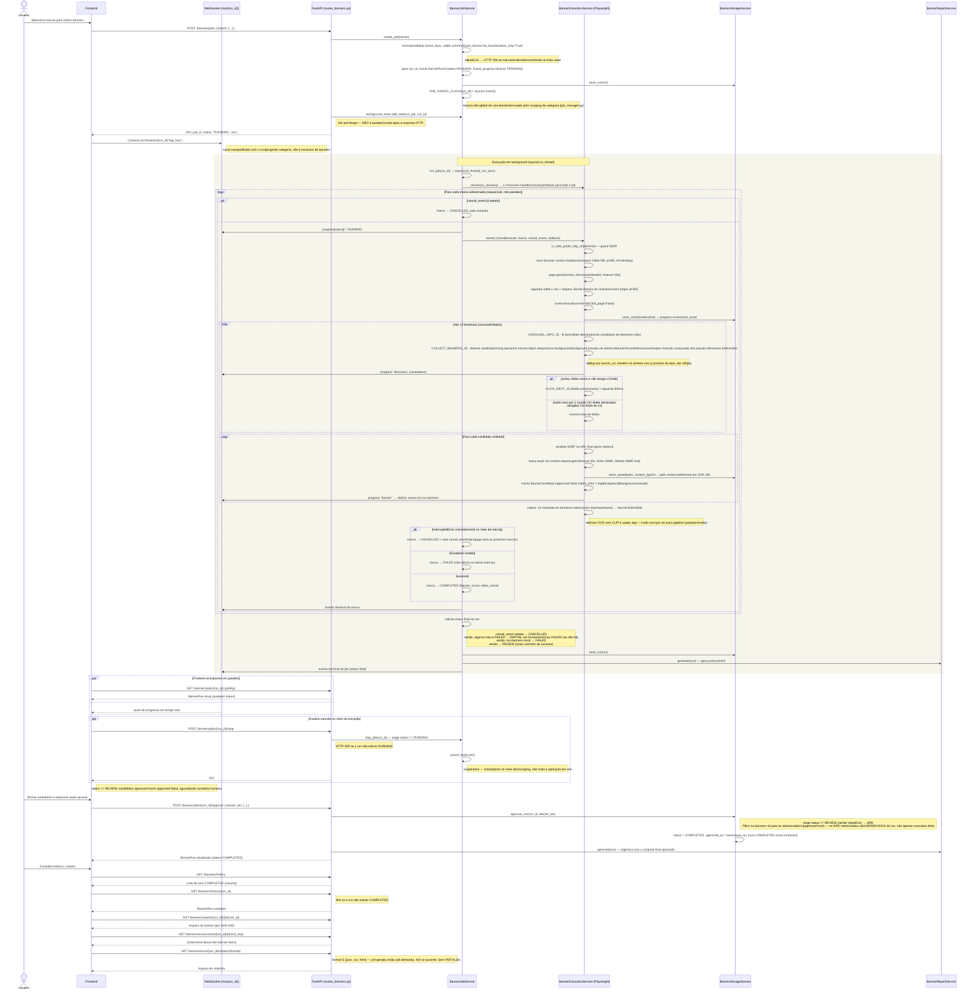

# Diagramas de Arquitetura (corrigidos)

> Gerado a partir de auditoria do diagrama original contra o código real (2026-07-11).
> Cada correção relevante está anotada com `%% FIX:` no bloco Mermaid correspondente.
> Diagrama 8 (Extração de Banners) foi criado do zero em 2026-07-11 — não existia no material original, só aparecia como componente (diagrama 1) e entidades (diagrama 2).

## 1. Visão geral de componentes

---

## 2. Modelo de dados (ERD)

```mermaid
erDiagram
    BRANDS_JSON {
        string brand_key PK "ex: aramis, reserva"
        string brand_name
        string domain
        string engine "vtex|shopify|sfcc|wake|zara|mercadolivre|netshoes|amazon (str livre, não enum)"
        boolean is_active
        string review_provider "trustvox|vtex_native|none (str livre)"
        string review_provider_evidence "FIX: campo real ausente no diagrama original"
        string review_unsupported_reason "FIX: campo real ausente no diagrama original"
        string review_store_id
        string vtex_account
        string logo_url
        string search_url_template
        string proxy_url
        string wake_access_token
    }

    CATEGORY_MAPPING {
        string canonical_slug "FIX: NÃO é PK global — se repete entre marcas.\nChave natural real = (brand_key, canonical_slug).\nVive embutido em brands.json[brand].mappings[], não em arquivo próprio"
        string vtex_fq_path
        string label
    }

    SEARCH_HISTORY_JSON {
        string job_id PK
        string query
        string target_sku
        string type "search|cross"
        string_array brands
        string status "PENDING|COMPLETED|FAILED"
        string created_at
        json results "FIX: shape difere totalmente por type — ver SEARCH_RESULT vs CROSS_RESULT"
        string error
    }

    SEARCH_RESULT {
        string brand
        string product_name
        string url
        float price_full
        float price_discount
        boolean price_discount_is_delta "FIX: campo real ausente"
        string image_url
        string category
        boolean available
        string product_code
        float rating
        int review_count
        string_array available_colors
        string_array available_sizes
        string sku_id
        string seller_id
        string scan_product_id "FIX: campo real ausente"
        json shipping "FIX: campo real ausente (ShippingInfo aninhado)"
        json_array shipping_options "FIX: campo real ausente"
        float landed_price "FIX: campo real ausente (calculado)"
        json_array review_comments "FIX: campo real ausente"
        string _obs "usado apenas quando type=search"
    }

    CROSS_RESULT {
        string marketplace "FIX: entidade nova — type=cross usa shape TOTALMENTE diferente de SEARCH_RESULT"
        string seller
        string title
        float price
        float text_match_score
        float image_match_score
        float final_match_score
        boolean is_buybox_winner
        int variant_count
        string shipping_state
    }

    PRICE_MONITORS_JSON {
        string job_id PK
        string url
        string brand
        int interval_minutes
        int duration_hours
        string start_time
        float last_price
        float last_price_original
        float last_price_discount "FIX: campo real ausente no diagrama original"
        string last_status "ok|blocked|error|null"
        string last_error
        string last_checked_at
        boolean active
        string image_url
        string product_name
        string_array available_colors
        string_array available_sizes
    }

    PRICE_HISTORY_ENTRY {
        string timestamp
        float price
        float price_original
        float price_discount "FIX: campo real ausente no diagrama original"
        boolean available
        string_array available_colors
        string_array available_sizes
    }

    NLP_VOCABULARY_JSON {
        string_array colors "FIX: campos totalmente renomeados — nenhum dos 3 campos originais bate com o arquivo real"
        string_array brand_names
        string_array category_words
        string_array stop_words
        string_array noise_words
        string_array known_brands_for_brand_detection
        json category_synonyms
    }

    MONITORED_CATEGORIES_JSON {
        string id PK "FIX: PK real é 'id' (UUID), não 'category_slug'. Arquivo é ARRAY, não dict"
        string url
        string brand "FIX: string singular, não brands[]"
        string status
        string last_scraped_at "FIX: nome real, não 'last_scan'"
        json last_stock_summary "FIX: objeto aninhado, não 'product_count' flat"
        int last_map_violation_count "FIX: campo real ausente"
    }

    SHIPPING_MATRIX_CACHE_JSON {
        string cache_key PK "FIX: formato real é '{product_url}|{cep}', não 'brand:sku:cep'"
        json result "FIX: nome real do campo, não 'shipping_data'. Contém region/capital/cep/state/shipping/message/cached"
        string checked_at "FIX: nome real, não 'cached_at'"
    }

    BANNER_RUN {
        string run_id PK
        string_array selected_brands
        string status "RUNNING|REVIEW|COMPLETED|PARTIAL|CANCELLED|FAILED"
        json brand_progress
        string created_at
        string approved_at
        string updated_at "FIX: campo real ausente"
        string error "FIX: campo real ausente"
    }

    BANNER_CANDIDATE {
        string banner_id PK "brand-order-sha256"
        string brand_key
        string brand_name
        int slide_order
        string friendly_filename
        json asset "sha256, extension, content_type, byte_count (FIX: não 'bytes')"
        string source_url
        string rendered_url "FIX: campo real ausente (distinto de source_url)"
        string click_url
        string alt_text
        string dom_kind "img|background|background-pseudo (FIX: str livre, não enum enforced, default 'img')"
        int rendered_width
        int rendered_height
        int natural_width "FIX: campo real ausente"
        int natural_height "FIX: campo real ausente"
        string captured_at "FIX: campo real ausente"
        boolean approved
    }

    BANNER_VIDEO_SLIDE {
        string brand_key
        int slide_order
        string source_url
    }

    STOCK_SUMMARY {
        string scan_id "FIX: frequentemente null na prática — identidade real é monitor_id"
        string brand "FIX: campo real ausente"
        string monitor_id "FIX: campo real ausente"
        int total_products
        int in_stock_count "FIX: nome real, não 'available_count'"
        int out_of_stock_count "FIX: nome real, não 'unavailable_count'"
        int unknown_stock_count "FIX: campo real ausente"
        int verified_stock_count "FIX: campo real ausente"
        float rupture_pct "FIX: campo real ausente"
        string scanned_at "FIX: nome real, não 'generated_at'"
    }

    CATEGORY_SCAN_SUMMARY {
        string scan_id PK "formato real 'uuid:brand' — FIX: é registro POR MARCA, não agregado por scan"
        string brand
        int total_products
        int in_stock_count
        int out_of_stock_count
        float rupture_pct
        string scanned_at
        string _obs "FIX: shape documentado originalmente (brand_results json + category + completed_at) não existe. Real = lista plana, mesmo shape de STOCK_SUMMARY"
    }

    RAW_PRODUCT_BRONZE {
        string url
        string brand
        string raw_title
        string raw_description
        float price_full
        float price_discount
        boolean price_discount_is_delta
        boolean stock_availability "opcional (Optional[bool]), não bool obrigatório"
        string category
        string sub_category
        string composition
        string product_code
        string_array raw_colors "FIX: campo real ausente"
        string_array raw_sizes "FIX: campo real ausente"
        string_array available_colors
        string_array available_sizes
        float rating
        int review_count
        string image_url
        json specifications "FIX: campo real ausente"
        string scan_product_id "FIX: campo real ausente"
        json shipping "FIX: campo real ausente (ShippingInfo aninhado)"
        boolean is_free_shipping "FIX: campo real ausente"
        float shipping_price "FIX: campo real ausente"
        string reviews_state "FIX: campo real ausente"
        json_array review_comments "FIX: campo real ausente"
        float landed_price "calculado"
    }

    SHIPPING_INFO {
        float price
        string status "FIX: str livre (visto: Gratis, Calculado no checkout), não enum fechado Disponível|Indisponível"
        int estimated_delivery_days
        string raw_text
        string service_name
        string service_id
        string estimate_display
        string estimate_unit "bd|d|h|m"
        boolean is_free_shipping
    }

    REVIEW_COMMENT {
        string review_id PK
        float rating
        string title
        string text
        string author
        string created_at
        string source_provider "trustvox|vtex_native (str livre, não enum enforced)"
        string source_ref
    }

    BRANDS_JSON ||--o{ CATEGORY_MAPPING : "mappings[] embutido"
    SEARCH_HISTORY_JSON ||--o{ SEARCH_RESULT : "results[] quando type=search"
    SEARCH_HISTORY_JSON ||--o{ CROSS_RESULT : "results[] quando type=cross"
    PRICE_MONITORS_JSON ||--o{ PRICE_HISTORY_ENTRY : history
    MONITORED_CATEGORIES_JSON ||--o{ RAW_PRODUCT_BRONZE : "monitored_products_{id}.json"
    MONITORED_CATEGORIES_JSON ||--o{ CATEGORY_SCAN_SUMMARY : gera
    BANNER_RUN ||--o{ BANNER_CANDIDATE : banners
    BANNER_RUN ||--o{ BANNER_VIDEO_SLIDE : video_slides
    RAW_PRODUCT_BRONZE ||--o| SHIPPING_INFO : shipping
    RAW_PRODUCT_BRONZE ||--o{ REVIEW_COMMENT : review_comments
```

---

## 3. Sequence: Category Monitor

---

## 4. Sequence: Price Monitor

---

## 5. Sequence: Orquestração Multi-marca

---

## 6. Sequence: Busca (single/multi-brand search)

---

## 7. Sequence: Cross-marketplace

```mermaid
sequenceDiagram
    actor Usuario as Usuário
    participant FE as Frontend
    participant API as FastAPI (routes_search.py)
    participant Hist as SearchHistoryService
    participant VtexClient as VtexApiClient
    participant Cross as CrossMarketplaceService
    participant ML as Mercado Livre Engine
    participant NS as Netshoes Engine
    participant AZ as Amazon Engine
    participant Nlp as NLP Service
    participant Img as Image AI (CLIP)
    participant Gates as relevance_gates.py
    participant Ship as Shipping Calculator

    Usuario->>FE: Seleciona produto Aramis (SKU) + CEP
    FE->>API: POST /search/cross-marketplace (target_sku, search_query?, broad_query?, min_score, zipcode)
    API->>API: verify_api_key

    alt search_query não fornecida
        API->>VtexClient: search(target_sku, max=1) na Aramis
        VtexClient-->>API: Produto de referência (nome, imagem, preço)
    end
    API->>API: Monta strict_query (nome completo) e\nbroad_query (categoria + tokens + Aramis)
    API->>API: remove_colors(broad_query) + remove_colors(strict_query)
    API->>Hist: create_job(job_id, query, brands=[ml,ns,az], type=cross, target_sku)
    API->>Cross: compare_product(broad_query, strict_query, target_sku, min_score, zipcode)
    Note right of API: FIX: compare_product também recebe\nmin_score, ausente no diagrama original

    par Fetch All Engines (timeout por motor — valores confirmados corretos)
        Cross->>ML: search(broad_query, max=30) [timeout=100s]
        Note right of ML: 100s calibrado deliberadamente para o\nfallback curl_cffi→Playwright do ML\n(~92s pior caso) — config.py:\nML_TIMEOUT_PLAYWRIGHT_SECONDS
        Cross->>NS: search(broad_query, max=30) [timeout=30s]
        Cross->>AZ: search(broad_query, max=30) [timeout=30s]
        ML-->>Cross: Produtos brutos
        NS-->>Cross: Produtos brutos
        AZ-->>Cross: Produtos brutos
    end

    Cross->>ML: search(target_sku) → imagem de referência Aramis
    Note right of Cross: FIX: essa busca (via VTEXEngine("aramis"),\nclasse DIFERENTE da usada no passo inicial\nVtexApiClient) roda logo após o fetch dos\nengines, ANTES do scoring NLP — não\numa etapa de CV tardia

    Note over Cross: Etapa 1: NLP Scoring
    Cross->>Nlp: calculate_text_score() p/ cada produto
    Nlp-->>Cross: text_match_score (0-100)
    Cross->>Gates: select_top_candidates_per_platform()

    Note over Cross: Etapa 2: Computer Vision
    Cross->>Img: get_embedding_async(ref_image) + batch embeddings candidatos
    Note right of Img: FIX: nome real é get_embedding_async,\nnão get_embedding
    Img-->>Cross: image_match_score (0-100)
    Cross->>Gates: compute_final_match_score(text, image)

    Note over Cross: Etapa 3: Score Cutoff + Brand Gate (mesmo filtro) → Similar Fallback → Visual Tiebreak
    Cross->>Gates: compute_min_score_cutoff()
    Cross->>Nlp: passes_brand_gate() → brand_is_present()
    Note right of Nlp: FIX: brand_is_present() vive em\nnlp_service.py, chamado via wrapper\npasses_brand_gate() em\ncross_marketplace_service.py —\nNÃO em relevance_gates.py.\nOrdem real: cutoff+brand gate ANTES\ndo similar fallback (diagrama original\ninvertia essa ordem)
    Cross->>Gates: apply_similar_fallback()
    Cross->>Cross: apply_visual_tiebreak()
    Note right of Cross: FIX: vive em cross_marketplace_service.py,\nnão em relevance_gates.py
    Cross->>Gates: cap_results_per_platform()

    Note over Cross: Etapa 4: PDP Enrichment + Shipping
    par PDP + Frete (paralelo por produto)
        Cross->>ML: get_product_details(url) → seller real + preço PDP
        Cross->>NS: get_product_details(url) → seller real + preço PDP
        Cross->>AZ: get_product_details(url) → seller real + preço PDP
        Cross->>Ship: calculate_shipping(product, CEP) → "Tier 2"
    end
    Cross->>Gates: build_formatted_results()
    Cross->>Gates: dedup_results()
    Cross->>Gates: mark_buybox_winner()
    Cross-->>API: { results[], metrics, vision_active, similar_fallback, errors[] }
    API->>Hist: update_job(job_id, status=COMPLETED, results)
    API-->>FE: JSON response + reference_product
    FE-->>Usuario: Cards de produtos com seller, preço, frete, match %, buybox
```

---

## 8. Sequence: Extração de Banners

