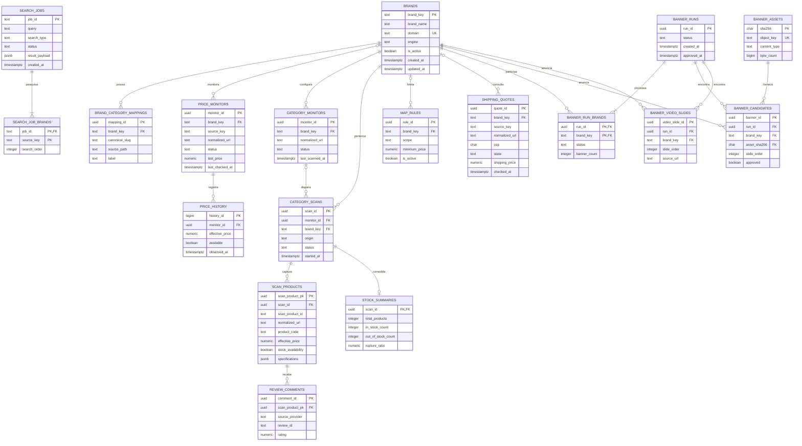
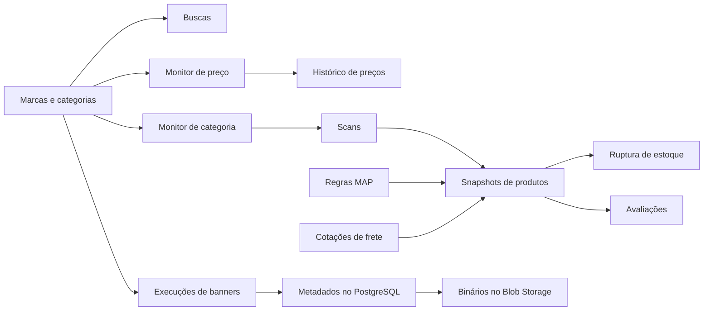

# Desenho do DDL — Intelligence Scraper

## 1. Premissas

Este é o desenho lógico e físico proposto para PostgreSQL 16 no Azure Database for PostgreSQL Flexible Server. A aplicação Docker deve ser stateless: PostgreSQL mantém os dados estruturados, Redis continua como cache efêmero e arquivos binários ficam em Azure Blob Storage.

Convenções:

- Entidades novas usam `uuid`.
- Datas usam `timestamptz` em UTC.
- Valores monetários usam `numeric(14,2)`, nunca `float`.
- Estados usam `text` com `CHECK`, facilitando evolução sem alterar tipos ENUM.
- Séries e relacionamentos são normalizados.
- `jsonb` é reservado para resultados heterogêneos, especificações e metadados variáveis.
- Tokens, credenciais e URLs de proxy não são armazenados no banco.
- Imagens e relatórios não usam `bytea`; o banco guarda checksum e chave do objeto.

## 2. Diagrama entidade-relacionamento

## 3. Dicionário de dados

### 3.1 `brands`

Cadastro das lojas e marcas suportadas.

| Coluna | Tipo | Regra | Descrição |
|---|---|---|---|
| `brand_key` | `varchar(63)` | PK; lowercase | Identificador estável, como `aramis` ou `hugoboss`. |
| `brand_name` | `varchar(160)` | NOT NULL | Nome para exibição. |
| `domain` | `varchar(255)` | NOT NULL, UNIQUE | Host canônico sem protocolo ou caminho. |
| `engine` | `varchar(32)` | NOT NULL, CHECK | `vtex`, `shopify`, `wake`, `sfcc`, `zara` etc. |
| `review_provider` | `varchar(40)` | NOT NULL DEFAULT `none` | Provedor de avaliações. |
| `review_store_id` | `varchar(120)` | NULL | Identificador público da loja no provedor. |
| `review_provider_evidence` | `text` | NULL | Evidência operacional da detecção. |
| `review_unsupported_reason` | `text` | NULL | Motivo quando reviews não são suportadas. |
| `vtex_account` | `varchar(120)` | NULL | Conta VTEX quando difere do domínio. |
| `logo_url` | `text` | NULL | URL pública do logotipo. |
| `search_url_template` | `text` | NULL | Template público de busca por marca. |
| `integration_settings` | `jsonb` | NOT NULL DEFAULT `{}`; objeto | Configuração pública extensível, sem segredos. |
| `is_active` | `boolean` | NOT NULL DEFAULT true | Controla participação em buscas e jobs. |
| `created_at` | `timestamptz` | NOT NULL DEFAULT `now()` | Criação. |
| `updated_at` | `timestamptz` | NOT NULL DEFAULT `now()` | Última alteração. |

Checks adicionais: `brand_key = lower(brand_key)` e `domain` não pode conter protocolo. Exclusão deve ser restringida quando houver histórico operacional.

### 3.2 `brand_category_mappings`

De/para entre categoria canônica e caminho real da loja.

| Coluna | Tipo | Regra | Descrição |
|---|---|---|---|
| `mapping_id` | `uuid` | PK | Identificador técnico. |
| `brand_key` | `varchar(63)` | FK → `brands`; ON DELETE CASCADE | Marca proprietária. |
| `canonical_slug` | `varchar(100)` | NOT NULL | Categoria canônica. |
| `source_path` | `text` | NOT NULL | Caminho/identificador na plataforma de origem. |
| `label` | `varchar(200)` | NOT NULL | Nome apresentado ao usuário. |
| `sort_order` | `integer` | NOT NULL DEFAULT 0; CHECK ≥ 0 | Ordem de exibição. |
| `created_at` | `timestamptz` | NOT NULL DEFAULT `now()` | Criação. |
| `updated_at` | `timestamptz` | NOT NULL DEFAULT `now()` | Atualização. |

Unique: `(brand_key, canonical_slug)`.

### 3.3 `search_jobs`

Histórico e estado de buscas comparativas ou por SKU.

| Coluna | Tipo | Regra | Descrição |
|---|---|---|---|
| `job_id` | `varchar(100)` | PK | ID já exposto pela API. |
| `query` | `text` | NOT NULL | Termo original. |
| `target_sku` | `varchar(160)` | NULL | SKU alvo na busca cross-marketplace. |
| `search_type` | `varchar(20)` | NOT NULL; CHECK | `search` ou `cross`. |
| `status` | `varchar(20)` | NOT NULL; CHECK | `PENDING`, `RUNNING`, `COMPLETED`, `FAILED`, `CANCELLED`. |
| `result_payload` | `jsonb` | NULL; array/objeto | Resultado heterogêneo preservado para reabertura. |
| `error_message` | `text` | NULL | Erro sanitizado. |
| `created_at` | `timestamptz` | NOT NULL DEFAULT `now()` | Criação. |
| `started_at` | `timestamptz` | NULL | Início da execução. |
| `completed_at` | `timestamptz` | NULL | Fim da execução. |

### 3.4 `search_job_brands`

Fontes selecionadas em cada busca. `source_key` não tem FK porque marketplaces virtuais também são fontes.

| Coluna | Tipo | Regra | Descrição |
|---|---|---|---|
| `job_id` | `varchar(100)` | PK parcial; FK → `search_jobs`; ON DELETE CASCADE | Busca. |
| `source_key` | `varchar(63)` | PK parcial | Marca ou marketplace pesquisado. |
| `search_order` | `smallint` | NOT NULL; CHECK ≥ 0 | Ordem original. |

PK composta: `(job_id, source_key)`. Unique adicional: `(job_id, search_order)`.

### 3.5 `price_monitors`

Configuração e último estado de um monitor de produto.

| Coluna | Tipo | Regra | Descrição |
|---|---|---|---|
| `monitor_id` | `uuid` | PK | Equivale ao `job_id` atual do monitor. |
| `brand_key` | `varchar(63)` | FK opcional → `brands`; ON DELETE RESTRICT | Marca cadastrada, quando existir. |
| `source_key` | `varchar(63)` | NOT NULL | Engine/marca/marketplace efetivamente consultado. |
| `product_url` | `text` | NOT NULL | URL original. |
| `normalized_url` | `text` | NOT NULL | URL canônica para deduplicação. |
| `interval_minutes` | `integer` | NOT NULL; CHECK > 0 | Intervalo entre verificações. |
| `duration_hours` | `integer` | NOT NULL; CHECK > 0 | Duração planejada. |
| `status` | `varchar(20)` | NOT NULL; CHECK | `active`, `paused`, `completed`, `error`. |
| `started_at` | `timestamptz` | NOT NULL DEFAULT `now()` | Início. |
| `last_price` | `numeric(14,2)` | NULL; CHECK ≥ 0 | Preço efetivo atual. |
| `last_original_price` | `numeric(14,2)` | NULL; CHECK ≥ 0 | Preço cheio atual. |
| `last_discount_price` | `numeric(14,2)` | NULL; CHECK ≥ 0 | Preço promocional atual. |
| `last_check_state` | `varchar(20)` | NULL; CHECK | `ok`, `blocked`, `error`, `unavailable`. |
| `last_error` | `text` | NULL | Último erro sanitizado. |
| `last_checked_at` | `timestamptz` | NULL | Última tentativa. |
| `image_url` | `text` | NULL | Imagem atual. |
| `product_name` | `text` | NULL | Nome atual. |
| `available_colors` | `text[]` | NOT NULL DEFAULT `{}` | Cores atuais. |
| `available_sizes` | `text[]` | NOT NULL DEFAULT `{}` | Tamanhos atuais. |
| `created_at` | `timestamptz` | NOT NULL DEFAULT `now()` | Criação. |
| `updated_at` | `timestamptz` | NOT NULL DEFAULT `now()` | Alteração. |

Unique parcial recomendado em `(source_key, normalized_url)` para monitores ativos.

### 3.6 `price_history`

Série temporal append-only do monitor.

| Coluna | Tipo | Regra | Descrição |
|---|---|---|---|
| `history_id` | `bigint GENERATED ALWAYS AS IDENTITY` | PK | Chave ordenável e compacta. |
| `monitor_id` | `uuid` | FK → `price_monitors`; ON DELETE CASCADE | Monitor proprietário. |
| `observed_at` | `timestamptz` | NOT NULL DEFAULT `now()` | Momento da observação. |
| `effective_price` | `numeric(14,2)` | NOT NULL; CHECK > 0 | Preço praticado. |
| `original_price` | `numeric(14,2)` | NULL; CHECK > 0 | Preço cheio. |
| `discount_price` | `numeric(14,2)` | NULL; CHECK > 0 | Preço promocional. |
| `available` | `boolean` | NOT NULL | Disponibilidade. |
| `available_colors` | `text[]` | NOT NULL DEFAULT `{}` | Cores observadas. |
| `available_sizes` | `text[]` | NOT NULL DEFAULT `{}` | Tamanhos observados. |

Unique: `(monitor_id, observed_at)`.

### 3.7 `category_monitors`

Configuração corrente de monitoramento de uma categoria.

| Coluna | Tipo | Regra | Descrição |
|---|---|---|---|
| `monitor_id` | `uuid` | PK | Identificador. |
| `brand_key` | `varchar(63)` | FK → `brands`; ON DELETE RESTRICT | Marca. |
| `category_url` | `text` | NOT NULL | URL original. |
| `normalized_url` | `text` | NOT NULL | URL canônica. |
| `status` | `varchar(20)` | NOT NULL; CHECK | `active`, `paused`, `error`. |
| `last_scanned_at` | `timestamptz` | NULL | Último scan concluído. |
| `last_map_violation_count` | `integer` | NOT NULL DEFAULT 0; CHECK ≥ 0 | Contador para leitura rápida. |
| `created_at` | `timestamptz` | NOT NULL DEFAULT `now()` | Criação. |
| `updated_at` | `timestamptz` | NOT NULL DEFAULT `now()` | Alteração. |

Unique: `(brand_key, normalized_url)`.

### 3.8 `category_scans`

Execução manual ou agendada de varredura. O histórico é preservado mesmo se o monitor for removido.

| Coluna | Tipo | Regra | Descrição |
|---|---|---|---|
| `scan_id` | `uuid` | PK | Identificador da execução. |
| `monitor_id` | `uuid` | FK opcional → `category_monitors`; ON DELETE SET NULL | Monitor de origem; nulo para scan manual. |
| `brand_key` | `varchar(63)` | FK → `brands`; ON DELETE RESTRICT | Marca varrida. |
| `origin` | `varchar(20)` | NOT NULL; CHECK | `manual` ou `scheduled`. |
| `status` | `varchar(20)` | NOT NULL; CHECK | `pending`, `running`, `completed`, `partial`, `failed`, `cancelled`. |
| `category_url` | `text` | NOT NULL | URL varrida naquele momento. |
| `error_message` | `text` | NULL | Erro da execução. |
| `started_at` | `timestamptz` | NOT NULL DEFAULT `now()` | Início. |
| `completed_at` | `timestamptz` | NULL | Término. |

### 3.9 `scan_products`

Snapshot de um produto em uma execução. Não é um catálogo mestre.

| Coluna | Tipo | Regra | Descrição |
|---|---|---|---|
| `scan_product_pk` | `uuid` | PK | Chave interna do snapshot. |
| `scan_id` | `uuid` | FK → `category_scans`; ON DELETE CASCADE | Execução. |
| `scan_product_id` | `varchar(160)` | NOT NULL | Identidade estável calculada pela aplicação. |
| `product_url` | `text` | NOT NULL | URL observada. |
| `normalized_url` | `text` | NOT NULL | URL canônica. |
| `raw_title` | `text` | NOT NULL | Título da fonte. |
| `raw_description` | `text` | NULL | Descrição da fonte. |
| `product_code` | `varchar(160)` | NULL | Código/SKU externo. |
| `category` | `varchar(200)` | NULL | Categoria principal. |
| `sub_category` | `varchar(200)` | NULL | Subcategoria. |
| `breadcrumb` | `text[]` | NOT NULL DEFAULT `{}` | Trilha de categorias. |
| `composition` | `text` | NULL | Composição. |
| `full_price` | `numeric(14,2)` | NOT NULL; CHECK > 0 | Preço cheio capturado. |
| `discount_price` | `numeric(14,2)` | NULL; CHECK > 0 | Preço promocional. |
| `effective_price` | `numeric(14,2)` | NOT NULL; CHECK > 0 | Preço efetivo materializado. |
| `stock_availability` | `boolean` | NULL | `NULL` significa desconhecido. |
| `available_colors` | `text[]` | NOT NULL DEFAULT `{}` | Cores normalizadas. |
| `available_sizes` | `text[]` | NOT NULL DEFAULT `{}` | Tamanhos normalizados. |
| `raw_colors` | `text[]` | NOT NULL DEFAULT `{}` | Valores brutos. |
| `raw_sizes` | `text[]` | NOT NULL DEFAULT `{}` | Valores brutos. |
| `rating` | `numeric(3,2)` | NULL; CHECK 0..5 | Nota. |
| `review_count` | `integer` | NULL; CHECK ≥ 0 | Total de avaliações. |
| `reviews_state` | `varchar(30)` | NULL; CHECK | Estado de reviews. |
| `review_product_id` | `varchar(160)` | NULL | ID no provedor. |
| `specifications` | `jsonb` | NOT NULL DEFAULT `{}`; objeto | Atributos variáveis por engine. |
| `image_url` | `text` | NULL | Imagem. |
| `seller` | `varchar(200)` | NULL | Seller observado. |
| `shipping` | `jsonb` | NULL; objeto | Snapshot compacto do frete. |
| `shipping_price` | `numeric(14,2)` | NULL; CHECK ≥ 0 | Frete selecionado. |
| `is_free_shipping` | `boolean` | NOT NULL DEFAULT false | Frete grátis confirmado. |
| `landed_price` | `numeric(14,2)` | NULL; CHECK ≥ 0 | Produto + frete. |
| `stock_depth_estimate` | `integer` | NULL; CHECK ≥ 0 | Estoque máximo observado/estimado. |
| `stock_depth_state` | `varchar(30)` | NULL; CHECK | Estado do probe aprofundado. |
| `stock_depth_source` | `varchar(80)` | NULL | Provider/método. |
| `stock_depth_checked_at` | `timestamptz` | NULL | Data do probe. |
| `map_violation` | `boolean` | NOT NULL DEFAULT false | Violação calculada no snapshot. |
| `map_rule_id` | `uuid` | FK opcional → `map_rules`; ON DELETE SET NULL | Regra aplicada. |
| `captured_at` | `timestamptz` | NOT NULL DEFAULT `now()` | Captura. |

Unique: `(scan_id, scan_product_id)`.

### 3.10 `stock_summaries`

Resumo 1:1 de estoque por scan.

| Coluna | Tipo | Regra | Descrição |
|---|---|---|---|
| `scan_id` | `uuid` | PK; FK → `category_scans`; ON DELETE CASCADE | Scan resumido. |
| `total_products` | `integer` | NOT NULL; CHECK ≥ 0 | Total. |
| `in_stock_count` | `integer` | NOT NULL; CHECK ≥ 0 | Em estoque. |
| `out_of_stock_count` | `integer` | NOT NULL; CHECK ≥ 0 | Esgotados. |
| `unknown_stock_count` | `integer` | NOT NULL; CHECK ≥ 0 | Sem evidência. |
| `verified_stock_count` | `integer` | NOT NULL; CHECK ≥ 0 | Com evidência. |
| `rupture_ratio` | `numeric(9,6)` | NULL; CHECK 0..1 | Percentual em forma decimal. |
| `calculated_at` | `timestamptz` | NOT NULL DEFAULT `now()` | Cálculo. |

Invariantes: `verified_stock_count = in_stock_count + out_of_stock_count` e `total_products = verified_stock_count + unknown_stock_count`.

### 3.11 `review_comments`

Comentários compactos coletados sob demanda.

| Coluna | Tipo | Regra | Descrição |
|---|---|---|---|
| `comment_id` | `uuid` | PK | Chave interna. |
| `scan_product_pk` | `uuid` | FK → `scan_products`; ON DELETE CASCADE | Produto do scan. |
| `source_provider` | `varchar(50)` | NOT NULL | Provedor. |
| `review_id` | `varchar(200)` | NOT NULL | ID no provedor. |
| `rating` | `numeric(3,2)` | NULL; CHECK 0..5 | Nota. |
| `title` | `text` | NULL | Título. |
| `body` | `text` | NULL | Comentário. |
| `author_name` | `varchar(200)` | NULL | Autor exibido. |
| `review_created_at` | `timestamptz` | NULL | Data original. |
| `source_ref` | `text` | NULL | Referência pública compacta. |
| `collected_at` | `timestamptz` | NOT NULL DEFAULT `now()` | Coleta. |

Unique: `(scan_product_pk, source_provider, review_id)`.

### 3.12 `map_rules`

Regras de preço mínimo anunciado.

| Coluna | Tipo | Regra | Descrição |
|---|---|---|---|
| `rule_id` | `uuid` | PK | Identificador. |
| `scope` | `varchar(20)` | NOT NULL; CHECK | `brand`, `category` ou `product`. |
| `brand_key` | `varchar(63)` | FK opcional → `brands`; ON DELETE RESTRICT | Marca alvo. |
| `target_label` | `text` | NOT NULL | Nome/descrição da regra. |
| `category` | `varchar(200)` | NULL | Obrigatória no escopo category. |
| `product_code` | `varchar(160)` | NULL | Código no escopo product. |
| `product_url` | `text` | NULL | URL original opcional. |
| `normalized_url` | `text` | NULL | URL canônica. |
| `minimum_price` | `numeric(14,2)` | NOT NULL; CHECK > 0 | Piso. |
| `notes` | `text` | NULL | Observação. |
| `is_active` | `boolean` | NOT NULL DEFAULT true | Ativação. |
| `created_at` | `timestamptz` | NOT NULL DEFAULT `now()` | Criação. |
| `updated_at` | `timestamptz` | NOT NULL DEFAULT `now()` | Alteração. |

Um `CHECK` por escopo deve exigir `brand_key`, `category` ou identificação de produto conforme aplicável.

### 3.13 `shipping_quotes`

Última cotação conhecida por produto, CEP e fonte.

| Coluna | Tipo | Regra | Descrição |
|---|---|---|---|
| `quote_id` | `uuid` | PK | Identificador. |
| `brand_key` | `varchar(63)` | FK opcional → `brands`; ON DELETE SET NULL | Marca cadastrada. |
| `source_key` | `varchar(63)` | NOT NULL | Engine/marketplace. |
| `product_url` | `text` | NOT NULL | URL original. |
| `normalized_url` | `text` | NOT NULL | URL canônica. |
| `cep` | `char(8)` | NOT NULL; CHECK dígitos | Destino. |
| `region` | `varchar(40)` | NULL | Região. |
| `capital` | `varchar(100)` | NULL | Rótulo da capital. |
| `state` | `varchar(30)` | NOT NULL; CHECK | `available`, `unsupported`, `blocked`, `temporary_failure`, `unavailable`. |
| `shipping_price` | `numeric(14,2)` | NULL; CHECK ≥ 0 | Custo. |
| `delivery_days` | `integer` | NULL; CHECK ≥ 0 | Prazo. |
| `service_name` | `varchar(160)` | NULL | Modalidade. |
| `is_free_shipping` | `boolean` | NOT NULL DEFAULT false | Gratuidade confirmada. |
| `message` | `text` | NULL | Estado legível. |
| `details` | `jsonb` | NOT NULL DEFAULT `{}`; objeto | Metadados extensíveis do provider. |
| `checked_at` | `timestamptz` | NOT NULL | Verificação. |
| `expires_at` | `timestamptz` | NOT NULL | Expiração do cache. |

Unique: `(source_key, normalized_url, cep)` para upsert da cotação mais recente.

### 3.14 `banner_runs`

Execução do coletor de banners.

| Coluna | Tipo | Regra | Descrição |
|---|---|---|---|
| `run_id` | `uuid` | PK | Execução. |
| `status` | `varchar(20)` | NOT NULL; CHECK | `RUNNING`, `REVIEW`, `COMPLETED`, `PARTIAL`, `CANCELLED`, `FAILED`. |
| `error_message` | `text` | NULL | Erro geral. |
| `created_at` | `timestamptz` | NOT NULL DEFAULT `now()` | Criação. |
| `updated_at` | `timestamptz` | NOT NULL DEFAULT `now()` | Atualização. |
| `approved_at` | `timestamptz` | NULL | Aprovação final. |

### 3.15 `banner_run_brands`

Progresso de cada marca em uma execução.

| Coluna | Tipo | Regra | Descrição |
|---|---|---|---|
| `run_id` | `uuid` | PK parcial; FK → `banner_runs`; ON DELETE CASCADE | Execução. |
| `brand_key` | `varchar(63)` | PK parcial; FK → `brands`; ON DELETE RESTRICT | Marca. |
| `brand_name_snapshot` | `varchar(160)` | NOT NULL | Nome preservado no histórico. |
| `status` | `varchar(20)` | NOT NULL; CHECK | `PENDING`, `RUNNING`, `COMPLETED`, `FAILED`, `CANCELLED`. |
| `banner_count` | `integer` | NOT NULL DEFAULT 0; CHECK ≥ 0 | Banners. |
| `video_count` | `integer` | NOT NULL DEFAULT 0; CHECK ≥ 0 | Vídeos. |
| `error_message` | `text` | NULL | Erro da marca. |
| `screenshot_asset_sha256` | `char(64)` | FK opcional → `banner_assets`; ON DELETE RESTRICT | Screenshot da coleta. |

PK composta: `(run_id, brand_key)`.

### 3.16 `banner_assets`

Metadados de objetos binários armazenados fora do PostgreSQL.

| Coluna | Tipo | Regra | Descrição |
|---|---|---|---|
| `sha256` | `char(64)` | PK; CHECK hexadecimal | Identidade por conteúdo. |
| `object_key` | `text` | NOT NULL, UNIQUE | Chave no Blob Storage. |
| `extension` | `varchar(12)` | NOT NULL | Extensão normalizada. |
| `content_type` | `varchar(100)` | NOT NULL | MIME type. |
| `byte_count` | `bigint` | NOT NULL; CHECK > 0 | Tamanho. |
| `created_at` | `timestamptz` | NOT NULL DEFAULT `now()` | Armazenamento. |

### 3.17 `banner_candidates`

Slides de imagem encontrados em uma execução.

| Coluna | Tipo | Regra | Descrição |
|---|---|---|---|
| `banner_id` | `uuid` | PK | Identificador. |
| `run_id` | `uuid` | FK → `banner_runs`; ON DELETE CASCADE | Execução. |
| `brand_key` | `varchar(63)` | FK → `brands`; ON DELETE RESTRICT | Marca. |
| `asset_sha256` | `char(64)` | FK → `banner_assets`; ON DELETE RESTRICT | Imagem. |
| `slide_order` | `integer` | NOT NULL; CHECK ≥ 1 | Ordem. |
| `friendly_filename` | `text` | NOT NULL | Nome proposto. |
| `source_url` | `text` | NOT NULL | Origem. |
| `rendered_url` | `text` | NOT NULL | URL final renderizada. |
| `click_url` | `text` | NULL | Destino do banner. |
| `alt_text` | `text` | NULL | Texto alternativo. |
| `dom_kind` | `varchar(30)` | NOT NULL DEFAULT `img` | Tipo do elemento. |
| `rendered_width` | `integer` | NULL; CHECK > 0 | Largura renderizada. |
| `rendered_height` | `integer` | NULL; CHECK > 0 | Altura renderizada. |
| `natural_width` | `integer` | NULL; CHECK > 0 | Largura natural. |
| `natural_height` | `integer` | NULL; CHECK > 0 | Altura natural. |
| `captured_at` | `timestamptz` | NOT NULL DEFAULT `now()` | Captura. |
| `approved` | `boolean` | NOT NULL DEFAULT false | Seleção humana. |

Unique: `(run_id, brand_key, slide_order, asset_sha256)`.

### 3.18 `banner_video_slides`

Registro de slides de vídeo detectados, sem armazenar o vídeo.

| Coluna | Tipo | Regra | Descrição |
|---|---|---|---|
| `video_slide_id` | `uuid` | PK | Identificador. |
| `run_id` | `uuid` | FK → `banner_runs`; ON DELETE CASCADE | Execução. |
| `brand_key` | `varchar(63)` | FK → `brands`; ON DELETE RESTRICT | Marca. |
| `slide_order` | `integer` | NOT NULL; CHECK ≥ 1 | Ordem. |
| `source_url` | `text` | NULL | URL pública quando disponível. |

Unique: `(run_id, brand_key, slide_order)`.

## 4. Índices recomendados

| Tabela | Índice | Finalidade |
|---|---|---|
| `brands` | parcial em `brand_key WHERE is_active` | Listagem frequente de marcas ativas. |
| `brand_category_mappings` | `(brand_key, sort_order)` | Catálogo ordenado por marca. |
| `search_jobs` | `(created_at DESC)` e `(status, created_at DESC)` | Histórico e recuperação de jobs pendentes. |
| `price_monitors` | `(status, last_checked_at)` | Scheduler de monitores ativos. |
| `price_monitors` | parcial UNIQUE `(source_key, normalized_url) WHERE status = 'active'` | Deduplicação concorrente. |
| `price_history` | `(monitor_id, observed_at DESC)` | Série temporal por produto. |
| `category_monitors` | `(status, last_scanned_at)` | Scheduler de categorias. |
| `category_scans` | `(monitor_id, started_at DESC)` | Histórico de um monitor. |
| `category_scans` | `(brand_key, started_at DESC)` | Histórico manual/agregado por marca. |
| `scan_products` | `(scan_id, effective_price)` | Listagem/ordenação do snapshot. |
| `scan_products` | `(product_code)` WHERE não nulo | Busca por SKU. |
| `scan_products` | `(normalized_url)` | Resolução de identidade. |
| `scan_products` | `(scan_id, stock_availability)` | Resumo/filtragem de ruptura. |
| `scan_products` | GIN em `specifications` | Filtros analíticos por atributos. |
| `review_comments` | `(scan_product_pk, review_created_at DESC)` | Comentários do produto. |
| `map_rules` | parcial `(brand_key, scope) WHERE is_active` | Seleção da regra aplicável. |
| `shipping_quotes` | `(expires_at)` | Limpeza de cache expirado. |
| `banner_runs` | `(status, created_at DESC)` | Fila e histórico. |
| `banner_candidates` | `(run_id, brand_key, slide_order)` | Tela de revisão. |
| `banner_candidates` | parcial `(run_id) WHERE approved` | Relatório final aprovado. |

Não é recomendado criar GIN sobre `search_jobs.result_payload`: o uso atual recupera o resultado completo por `job_id`, sem consulta interna ao JSON.

## 5. Decisões de ownership e exclusão

| Pai | Filho | Política proposta | Motivo |
|---|---|---|---|
| `brands` | `brand_category_mappings` | CASCADE | Mapping não existe sem a marca. |
| `brands` | monitores/scans/MAP | RESTRICT | Não apagar histórico operacional silenciosamente. |
| `search_jobs` | `search_job_brands` | CASCADE | Parte integral do job. |
| `price_monitors` | `price_history` | CASCADE | Histórico pertence ao monitor; exclusão deve ser explícita. |
| `category_monitors` | `category_scans` | SET NULL | Scan histórico sobrevive à remoção da configuração. |
| `category_scans` | produtos/summary | CASCADE | Snapshot é uma unidade de retenção. |
| `scan_products` | `review_comments` | CASCADE | Comentário pertence ao snapshot. |
| `banner_runs` | progresso/candidates/videos | CASCADE | Execução é a unidade de retenção. |
| `banner_assets` | referências | RESTRICT | Evita apagar objeto ainda utilizado. |

## 6. Visão resumida por domínio

Este documento define o desenho. A migration SQL, os repositories Python e o ETL dos arquivos JSON devem ser tratados separadamente.
